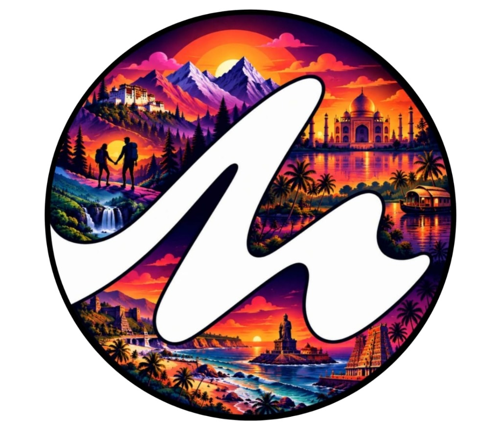

# M.A.T.E. — Meeting Adventure Travel Escape



**Connect with people. Discover places. Share experiences.**

M.A.T.E. (Meeting Adventure Travel Escape) is a next-generation social travel platform engineered to help travelers discover destinations, find highly compatible companions through **Travel DNA**, coordinate in dedicated **Trip Rooms**, and share authentic travel memories.

---

## 🧭 Product Principles

1. **Relationship-First:** Focuses on companion compatibility and shared trip coordination, rather than mere transactional bookings.
2. **Explainable Matching:** Companion matches highlight concrete compatibility factors (travel pace, budget tier, shared interests, dates) instead of opaque scores.
3. **OWASP-Aligned Security:** Multi-layered defense against IDOR/BOLA, parameterized persistence, strict rate limiting, and EXIF sanitization.
4. **Staged Computer Vision:** Photo duplicate and similarity workflows begin with SHA-256 exact checks, advance to perceptual hashing, and expand to semantic vision embeddings.

---

## 🛠️ Mandatory Technology Stack

| Layer | Technology | Details |
|---|---|---|
| **Web Frontend** | React.js, TypeScript, Vite, Tailwind CSS | Responsive, accessible, mobile-first design |
| **Mobile Apps** | Flutter & Dart | Genuine native iOS & Android applications |
| **Backend API** | Node.js, Express.js, TypeScript | Modular monolith under `/api/v1` with OpenAPI spec |
| **Database** | PostgreSQL | Relational transactional source of truth, PostGIS & pgvector |
| **Media Intelligence** | Python, FastAPI, OpenCV, PIL | EXIF scrubbing, SHA-256 exact & perceptual hashing (pHash) |
| **Containerization** | Docker & Docker Compose | Repeatable multi-service local & cloud environments |
| **Security** | OWASP Top 10, API Top 10, ASVS / MASVS | Parameterized queries, BOLA protection, rate limiting |

---

## 🏗️ Repository Architecture

```
MATE_MAIN/
├── apps/
│   ├── web/                     # React 18, TypeScript, Vite, Tailwind CSS web client
│   └── mobile/                  # Flutter & Dart native Android / iOS application
├── services/
│   ├── api/                     # Node.js + Express.js + TypeScript modular monolith
│   ├── image-processing/        # Python FastAPI + OpenCV + PIL image similarity engine
│   └── worker/                  # Background worker queue for async media & jobs
├── packages/
│   └── shared-contracts/        # OpenAPI 3.0 specification & shared schemas
├── infra/
│   └── docker/                  # Docker Compose and container manifests
├── docs/                        # Architecture decisions, RTM, threat models, guides
└── assets/
    └── branding/                # Official M.A.T.E. logo and brand assets
```

---

## 🎨 Brand Design Tokens

Derived directly from the official M.A.T.E. identity:
- **Sunset Orange:** `#FF5E36` / `#FF7A45`
- **Adventure Magenta:** `#E0287D` / `#D81B60`
- **Twilight Purple:** `#6C2EB9` / `#4A154B`
- **Midnight Navy:** `#0E1326` / `#161B33`
- **Surface Neutrals:** `#F8FAFC` (Light) / `#0F172A` (Dark)

---

## 🚀 Quickstart & Local Development

### Prerequisites
- Node.js >= 20.x
- Docker & Docker Compose
- Python 3.10+ (for image worker)

### 1. Local Environment Configuration
```bash
cp .env.example .env
```

### 2. Run with Docker Compose
```bash
docker compose -f infra/docker/docker-compose.yml up --build
```
- **Web App:** http://localhost:5173
- **API Monolith:** http://localhost:4000
- **API Health:** http://localhost:4000/api/v1/health
- **Image Processing Service:** http://localhost:8000

---

## 📖 Key Documentation
- [Requirements Traceability Matrix](docs/requirements-traceability.md)
- [Architecture Decision Records](docs/architecture-decisions.md)
- [Implementation Roadmap](docs/implementation-roadmap.md)
- [Security Threat Model](docs/security-threat-model.md)
- [Security Checklist](docs/security-checklist.md)
